<!-- ============ HERO (animated: stars + typing terminal + waves) ============ -->
<div align="center">



<br/>

<!-- ============ SOCIAL STRIP ============ -->
<table align="center">
<tr>
<td align="center">

<a href="https://linkedin.com/in/soumya-ranjan-behura-1a0896325"></a>
<a href="https://github.com/SoumyaRanjanBehura-27"></a>
<a href="mailto:soumyaranjanbehura27@gmail.com"></a>
<a href="https://mastodon.social/@SoumyaRanjanBehura"></a>

<!-- Add these back when you have real links:
<a href="YOUR_PORTFOLIO_URL"></a>
<a href="https://leetcode.com/u/YOUR_USERNAME/"></a>
<a href="https://www.hackerrank.com/profile/YOUR_USERNAME"></a>
-->

</td>
</tr>
</table>


</div>

<br/>

## `>_ about_me.py`

<table>
<tr>
<td width="60%" valign="top">

```python
class Developer:
    def __init__(self):
        self.name     = "Soumya Ranjan Behura"
        self.role     = "Python Full Stack Developer (Fresher)"
        self.location = "India 🇮🇳"
        self.mindset  = "Learn → Build → Break → Fix → Repeat"

        self.backend  = ["Python", "Django", "Flask", "FastAPI"]
        self.frontend = ["HTML5", "CSS3", "JavaScript", "Bootstrap", "React"]
        self.database = ["MySQL", "MongoDB"]
        self.tools    = ["Git", "GitHub", "VS Code", "Postman"]

        self.building = "Responsive websites & full stack projects"
        self.seeking  = ["Internships", "Entry-level roles", "Open source"]
        self.fun_fact = "I debug with print() and I'm not ashamed 😄"

    def say_hi(self):
        return "Let's build something awesome together! 🚀"

print(Developer().say_hi())
```

</td>
<td width="40%" valign="top" align="center">

#### ⚡ Quick Snapshot

| | |
|---|---|
| 🔭 **Working on** | Full stack web apps |
| 🌱 **Learning** | React, DSA, REST APIs |
| 💬 **Ask me about** | Python, HTML, CSS, JS |
| 🚀 **Superpower** | Never giving up |
| 🎯 **Goal** | First dev role 💼 |
| 📫 **Reach me** | [Email](mailto:soumyaranjanbehura27@gmail.com) |

</td>
</tr>
</table>

> 💭 *"Every expert was once a beginner who never gave up."*

---

## `>_ currently_learning()`

<div align="center">

<table>
<tr>
<td align="center" width="50%">

**🐍 Python & Backend**<br/><br/>
<br/>
<br/>


</td>
<td align="center" width="50%">

**🎨 Frontend**<br/><br/>
<br/>
<br/>


</td>
</tr>
<tr>
<td align="center" width="50%">

**🧠 Computer Science**<br/><br/>
<br/>


</td>
<td align="center" width="50%">

**🛠️ Workflow**<br/><br/>
<br/>


</td>
</tr>
</table>

</div>

#### 🗺️ Roadmap

| Stage | Focus | Status |
|:---:|:---|:---:|
| `01` | HTML5, CSS3, Responsive Design | ✅ Done |
| `02` | Python Fundamentals & OOP | ✅ Done |
| `03` | JavaScript (ES6+), Bootstrap | 🔄 In Progress |
| `04` | Django / Flask / FastAPI + REST APIs | ⏳ Up Next |
| `05` | React, Git workflows, Deployment | ⏳ Up Next |
| `06` | DSA, System Design basics, Open Source | 🎯 Planned |

---

## `>_ tech_stack`

<div align="center">

**🐍 Backend**<br/>


**🎨 Frontend**<br/>


**🗄️ Databases**<br/>


**📊 Data Tools**<br/>


**🛠️ Tools & Deployment**<br/>


</div>

---

## `>_ featured_projects`

<table>
<tr>
<td width="33%" valign="top">

### 🌐 Portfolio Website
Responsive personal site built with HTML, CSS & JavaScript.

`HTML` `CSS` `JS`

[🔗 View Repo](https://github.com/SoumyaRanjanBehura-27)

</td>
<td width="33%" valign="top">

### 🐍 Django Web App
Full stack app with authentication, CRUD & database.

`Python` `Django` `MySQL`

[🔗 View Repo](https://github.com/SoumyaRanjanBehura-27)

</td>
<td width="33%" valign="top">

### ⚡ REST API Project
Fast, documented API built with FastAPI.

`FastAPI` `Python` `MongoDB`

[🔗 View Repo](https://github.com/SoumyaRanjanBehura-27)

</td>
</tr>
</table>

---

## `>_ github_stats`

<div align="center">


<br/>


<br/>


</div>

<details>
<summary><b>🏆 GitHub Trophies</b></summary>
<br/>
<div align="center">

</div>
</details>
---

## `>_ quote_of_the_moment`
<div align="center">


</div>

---

## `>_ lets_connect`

I'm open to **internships, fresher roles, freelance gigs and collaborations**.
Got an idea, a bug, or a coffee ☕ to spare? Say hi!

<div align="center">

<a href="mailto:soumyaranjanbehura27@gmail.com"></a>
<a href="https://linkedin.com/in/soumya-ranjan-behura-1a0896325"></a>

<br/><br/>

⭐ **If you like my work, drop a star on my repos!** ⭐

<br/>


</div>
